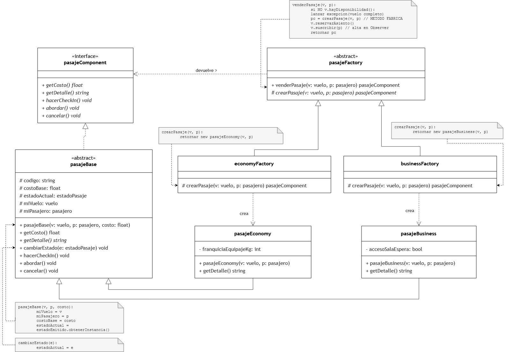
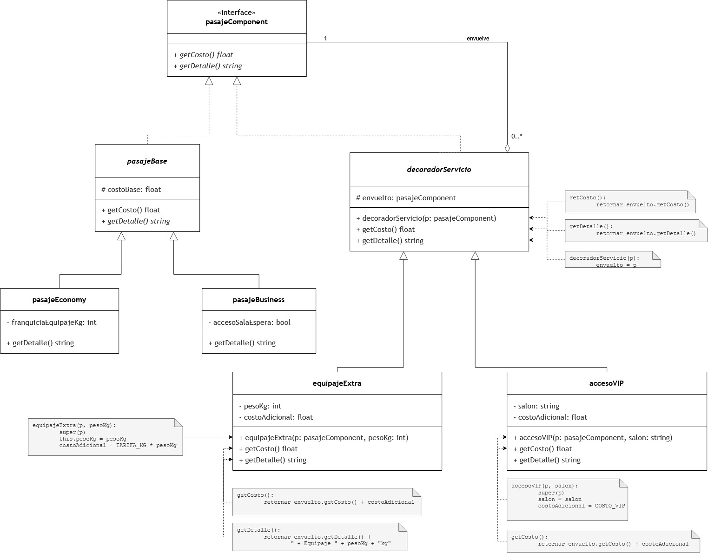
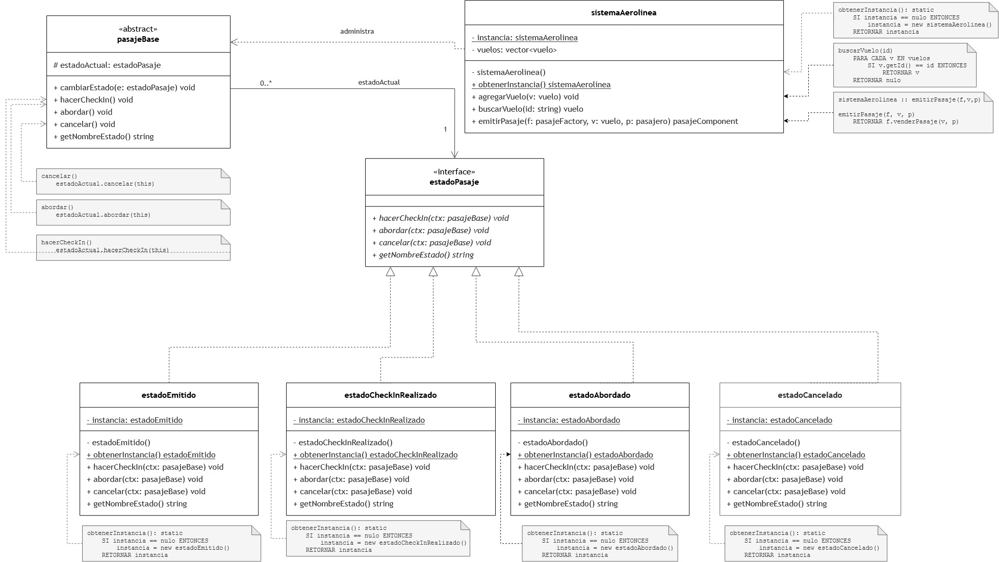
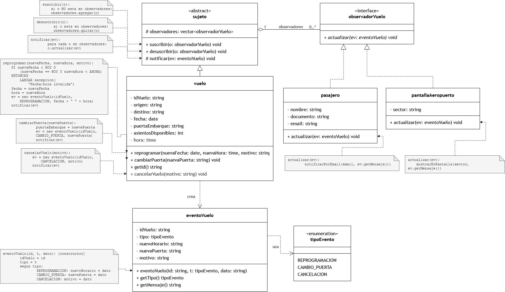

# Sistema de Gestión de Vuelos y Pasajes Aeronáuticos

**Trabajo Final - Patrones de Diseño (2026)**
Licenciatura en Informática
Facultad de Ciencias Exactas y Tecnología - Universidad Nacional de Tucumán

**Integrantes:** Campos Néstor Nazaret · Gramajo Juan Ignacio · Rollán Natalia

---

## Descripción

Sistema en C++17 que administra el ciclo de vida completo de un pasaje aéreo de una aerolínea de cabotaje: emisión del ticket según su clase, contratación de servicios adicionales, check-in y abordaje, y aviso automático a los interesados cuando un vuelo se reprograma o cambia de puerta.

La consigna pedía plantear un problema real que exigiera **al menos cinco patrones de diseño**, hacer el análisis y el diseño UML, implementarlo en un lenguaje orientado a objetos y documentarlo en un informe. Cada patrón resuelve un problema concreto del dominio:

| Problema del dominio | Patrón | Solución |
|---|---|---|
| Agregar una clase de pasaje nueva (p. ej. Premium Economy) obligaba a tocar el código de venta en varios lugares. | **Factory Method** | El módulo de ventas trabaja con una interfaz común; cada fábrica concreta decide qué pasaje instanciar. |
| Combinar servicios por herencia generaba una explosión de subclases (`PasajeEconomyConEquipajeYVip`...). | **Decorator** | Cada servicio envuelve al pasaje en tiempo de ejecución y suma su costo al total. |
| Validar el ciclo Emitido → Check-in → Abordado → Cancelado con `if`/banderas es frágil. | **State** | Cada estado es un objeto que conoce sus transiciones válidas y rechaza las demás. |
| El vuelo no debe depender de cada receptor de sus novedades (pasajeros, pantallas, tripulación). | **Observer** (modelo Push) | El vuelo notifica a una lista de observadores mediante un DTO `eventoVuelo`. |
| Varias copias del administrador de vuelos producirían sobreventa e inconsistencias. | **Singleton** | `sistemaAerolinea` es la única fuente de verdad. Los estados, al no tener atributos propios, también son Singleton y se comparten entre todos los pasajes. |

Los cinco patrones están conectados: `pasajeComponent` es a la vez el *Producto* de Factory Method y el *Componente* de Decorator; `venderPasaje()` valida el asiento, crea el pasaje y suscribe al pasajero al Observer del vuelo.

## Estructura del repositorio

```
├── README.md
├── src/                                   Código fuente en C++17 (una clase por par .h/.cpp)
│   └── main.cpp                           Cliente: recorre los 8 escenarios de demostración
├── diagramas/                             Diagramas UML detallados (.jpg para ver, .drawio editables)
│   ├── factory_method.*
│   ├── decorator.*
│   ├── state_singleton.*
│   └── observer.*
└── docs/
    ├── Consigna_Trabajo_Final.pdf         Consigna de la cátedra
    ├── Informe_Trabajo_Final.docx         Informe: requerimientos, diagramas y decisiones de diseño
    └── Presentacion_Trabajo_Final.pptx    Presentación usada en la defensa
```

## Escenarios de demostración

Al ejecutarse, `main.cpp` recorre ocho escenarios que muestran cada patrón en funcionamiento, en orden:

1. **Singleton:** dos llamadas a `obtenerInstancia()` devuelven la misma dirección.
2. **Factory Method:** dos pasajes distintos emitidos con la misma llamada, cambiando solo la fábrica concreta.
3. **Decorator:** el costo pasa de `$85.000` a `$165.500` y a `$189.500` al apilar equipaje extra y Salón VIP.
4. **State:** se rechaza abordar sin check-in y cancelar un pasaje ya abordado; el ciclo válido avanza.
5. **Singleton en los estados:** todos los pasajes en el mismo estado comparten un único objeto.
6. **Observer:** la reprogramación y el cambio de puerta llegan a los pasajeros y a la pantalla; tras `desuscribir()`, el pasajero deja de recibir avisos.
7. **Validación de negocio:** `venderPasaje()` rechaza la venta por falta de asientos antes de instanciar nada.
8. **Liberación de memoria:** se destruye la pila de decoradores y luego el sistema con sus vuelos.

Fragmento de la salida:

```
===========================================================
 4. STATE - ciclo de vida del pasaje
===========================================================
   Estado inicial del pasaje 2: Emitido

   Recorrido valido:
   [ERROR] abordar()       -> Debe hacer el check-in antes de abordar
   [OK]    hacerCheckIn()  -> estado: Check-in realizado
   [OK]    abordar()       -> estado: Abordado
```

## Diagramas UML

Cada clase del código corresponde exactamente a una clase del diagrama, con los mismos atributos, métodos y niveles de visibilidad. Los métodos que definen cada patrón llevan como comentario el mismo pseudocódigo que figura en las notas del diagrama.

<details>
<summary><b>Factory Method</b>: creación desacoplada de pasajes</summary>


</details>

<details>
<summary><b>Decorator</b>: servicios adicionales acumulativos</summary>


</details>

<details>
<summary><b>State y Singleton</b>: ciclo de vida del pasaje</summary>


</details>

<details>
<summary><b>Observer</b>: notificación de novedades del vuelo</summary>


</details>

| Patrón | Rol | Archivos en `src/` |
|---|---|---|
| **Factory Method** | Producto | `pasajeComponent.h` |
| | Productos Concretos | `pasajeEconomy.*`, `pasajeBusiness.*` |
| | Creador | `pasajeFactory.*` |
| | Creadores Concretos | `economyFactory.*`, `businessFactory.*` |
| **Decorator** | Componente | `pasajeComponent.h` |
| | Componentes Concretos | `pasajeEconomy.*`, `pasajeBusiness.*` |
| | Decorador | `decoradorServicio.*` |
| | Decoradores Concretos | `equipajeExtra.*`, `accesoVIP.*` |
| **State** | Contexto | `pasajeBase.*` |
| | Estado | `estadoPasaje.h` |
| | Estados Concretos | `estadoEmitido.*`, `estadoCheckInRealizado.*`, `estadoAbordado.*`, `estadoCancelado.*` |
| **Singleton** | Singleton | `sistemaAerolinea.*` y los cuatro estados concretos |
| **Observer** | Sujeto | `sujeto.*` |
| | Sujeto Concreto | `vuelo.*` |
| | Observador | `observadorVuelo.h` |
| | Observadores Concretos | `pasajero.*`, `pantallaAeropuerto.*` |
| | DTO del modelo Push | `eventoVuelo.*`, `tipoEvento.h` |

## Decisiones de diseño

- **State en lugar de banderas.** Se descartaron atributos como `bool checkInHecho`: obligan a repetir controles en cada método. Con State, `pasajeBase` delega en el estado vigente, que lanza `std::logic_error` ante una transición inválida.
- **Estados Singleton.** Los estados no guardan datos por pasaje, así que un vuelo de 200 pasajeros usa 4 objetos de estado y no 200.
- **Observer con modelo Push.** En lugar de que cada observador consulte al vuelo (Pull), el vuelo envía un DTO `eventoVuelo` con lo que cambió, sin exponer su estado interno.
- **Factory Method frente a las alternativas.** Una fábrica simple con `switch` igual obliga a modificar código para cada clase nueva, y Abstract Factory no aplica porque no hay familias de productos. El creador conserva la lógica de negocio (`venderPasaje()`) y delega en `crearPasaje()`, que es protegido, solo la instanciación.
- **Interfaces en C++.** `pasajeComponent`, `estadoPasaje` y `observadorVuelo` son clases con métodos virtuales puros y destructor virtual. Sin este último, borrar un `pasajeComponent*` que apunta a un `accesoVIP` no destruiría la pila de decoradores.
- **Propiedad de los objetos.** `sistemaAerolinea` *compone* los vuelos y los libera; cada decorador es dueño del componente que envuelve; `sujeto` solo *agrega* a sus observadores (por eso `desuscribir()` es indispensable); los estados no los crea ni destruye ningún pasaje.

El análisis completo está en el [informe](docs/Informe_Trabajo_Final.docx).
